# 第5章 镜像下降与单纯形演化图神经网络（19个算子）深度学术与教学审计报告

> **审计基准**：陈智超博士论文《基于泛函优化的概率隐变量建模理论及软测量应用》  
> **审计对象**：第5章《基于单纯形镜像下降的演化邻接图神经网络及其工业软测量应用》（19个算子）  
> **数据文件**：`chapter_slices/ch5.json` | 动画源码：`source_app/js_anim_ch5.js` | 全局矩阵：`audit_matrix.json`  
> **生成时间**：2026-10-15  

---

## 一、报告引言与章节综述

### 1.1 章节核心定位与学术脉络
在复杂连续工业过程（如催化裂化、精馏塔分离、高炉炼铁）中，各过程变量（PV）之间存在复杂的物料平衡、能量传递与动态耦合。传统图卷积网络（GCN）和消息传递神经网络（MPNN）预先假定静态、确定性的邻接拓扑矩阵，无法应对工况切换、负荷漂移与传感器时变相关性。

陈智超博士在第5章中提出了**演化邻接图神经网络（Entropy-Regularized Evolutionary Adjacency Graph, E²AG）**与**核熵单纯形镜像迭代（Kernel Entropy Mirror Simplex, KEMS）**算法。其核心数学创新在于：
1. **行概率约束的几何化**：将邻接矩阵的每一行看作支撑在概率单纯形 $\Delta^{D_{PV}-1}$ 上的狄利克雷（Dirichlet）先验分布或离散概率测度；
2. **克服 Dirichlet 熵的计算瓶颈**：针对狄利克雷微分熵中 Gamma/Digamma 函数在深度学习自动微分中求导不稳定、高方差的缺陷，将其重构为粒子形式的负熵正则泛函 $\mathcal{L}_{\mathrm{ER}}$；
3. **镜像下降与保单纯形投影**：在再生核希尔伯特空间（RKHS）中推导微扰方向 $\phi_{\mathrm{RKHS}}$，并通过负熵布雷格曼势（Entropy Bregman Potential）建立镜像映射（Mirror Map），将单纯形内部的有约束变分转换为对偶空间中的无约束欧拉演化，再通过 Softmax 归一化指数映射自然拉回单纯形，实现 $100\%$ 的行和保 1 与非负性闭环。

```mermaid
flowchart TD
    subgraph S1["空间拓扑输入"]
        A["nam_normalize<br/>归一化邻接矩阵 A"] --> B["simplex_factorization<br/>单纯形行因子化 P(A|x)"]
        MP1["mpnn_message<br/>MPNN消息聚合"] --> MP2["mpnn_update<br/>MPNN节点更新"]
    end

    subgraph S2["变分目标与泛函微扰"]
        B --> DE["dirichlet_entropy<br/>Dirichlet熵泛函 (5-5)"]
        MP1 --> IL["implicit_likelihood<br/>隐式期望似然 (5-8)"]
        IL --> ERF["entropy_regularized_functional<br/>熵正则泛函 L_ER (5-9)"]
        ERF --> FP["functional_perturbation<br/>泛函微扰差 (5-10)"]
        FP --> RPD["rkhs_perturbation_direction<br/>RKHS微扰方向 φ_RKHS (5-16)"]
        RPD --> KLD["kl_descent_sufficient_condition<br/>KL下降充分条件 (5-20)"]
    end

    subgraph S3["镜像几何与流形投影"]
        B --> EBP["entropy_bregman_potential<br/>熵布雷格曼势 (5-25)"]
        EBP --> EBD["entropy_bregman_divergence<br/>熵布雷格曼散度 (5-26)"]
        EBP --> MML["mirror_map_log<br/>镜像映射 log/exp (5-28)"]
        RPD --> KEMS["kems_simplex_update<br/>KEMS单纯形迭代 (5-28)"]
        EBD --> KEMS
        MML --> KEMS
        KEMS --> FEO["forward_euler_ode<br/>前向欧拉离散 (5-35)"]
    end

    subgraph S4["E²AG 神经网络前向架构"]
        EL["embed_layer<br/>嵌入层 (5-40)"] --> NMA["nam_message_average<br/>加权消息平均 (5-41)"]
        KEMS --> NMA
        NMA --> RFU["residual_feature_update<br/>残差特征更新 (5-42)"]
        RFU --> RMD["relu_mlp_decoder<br/>ReLU MLP解码器 (5-43)"]
    end

    style S1 fill:#1a1d24,stroke:#3b82f6,stroke-width:1.5px
    style S2 fill:#1a1d24,stroke:#10b981,stroke-width:1.5px
    style S3 fill:#1a1d24,stroke:#f59e0b,stroke-width:1.5px
    style S4 fill:#1a1d24,stroke:#8b5cf6,stroke-width:1.5px
```



### 1.2 审计全景统计与质量矩阵
第5章共包含 **19 个算子**。经本次地毯式审计，总体评价如下：
- **评级分布**：优秀（A级）14个（占比 73.7%），良好（B+级）5个（占比 26.3%），无 C/D 级算子。
- **论文摘录截断率**：0%（19个算子均维持了规范的摘录截断边界，无破损句式）。
- **拓扑端点/悬挂节点**：5 个出度为 0 的叶节点（`mpnn_update`, `dirichlet_entropy`, `kl_descent_sufficient_condition`, `forward_euler_ode`, `relu_mlp_decoder`），属于算法分支收敛点或前向预测终点。
- **核心数学与理论漏洞**：
  1. `dirichlet_entropy` 原文公式 (5-7) 存在严重数学笔误：将双伽马（Digamma）函数定义为 $\mathrm{DiGa}(\theta) = \frac{d\Gamma(\theta)}{d\theta}$（遗漏除以 $\Gamma(\theta)$）；且式 (5-5) 符号混淆并反转了正负号；
  2. `rkhs_perturbation_direction` 在微扰积分中混淆了全图邻接测度与单行条件分布的测度变换；
  3. `kems_simplex_update` 论文推导省略了拉格朗日乘子 $\lambda$ 维持单纯形全约束的紧流形变分条件。

---

## 二、算子全景图谱与拓扑依赖链审计

### 2.1 拓扑链路层级与依赖关系
19个算子沿 4 条核心逻辑线展开：
1. **经典图神经网络基准线**（`mpnn_message` $\to$ `mpnn_update`；`nam_normalize` $\to$ `simplex_factorization`）：从经典确定性图传播引出工业变量行随机矩阵约束。
2. **泛函优化目标推导线**（`simplex_factorization` $\to$ `implicit_likelihood` $\to$ `entropy_regularized_functional` $\to$ `functional_perturbation` $\to$ `rkhs_perturbation_direction` $\to$ `kl_descent_sufficient_condition`）：在 RKHS 内利用无限小微扰差证明泛函下降方向。
3. **单纯形镜像几何闭环线**（`entropy_bregman_potential` $\to$ `entropy_bregman_divergence` $\to$ `mirror_map_log` $\to$ `kems_simplex_update` $\to$ `forward_euler_ode`）：利用信息几何对偶性，解决有界单纯形上的欧拉离散溢出问题。
4. **E²AG 工程前向架构线**（`embed_layer` $\to$ `nam_message_average` $\to$ `residual_feature_update` $\to$ `relu_mlp_decoder`）：将 KEMS 演化出的动态邻接权重接入多层感知机解码器，完成关键指标（如轻柴油凝固点、丙烯收率）的软测量。

### 2.2 悬挂节点（Leaf Nodes）学术合理性论证
- `mpnn_update`（出度 0）：经典 MPNN 的特征更新对比项，作为 E²AG 提出前的话题背景，拓扑终止合理；
- `dirichlet_entropy`（出度 0）：负面靶子（Ablation Target），作为反面证明“为什么深度学习不能直接用 Dirichlet 熵求导”，拓扑闭环成立；
- `kl_descent_sufficient_condition`（出度 0）：理论保证引理（Lemma 5.1 / Theorem 5.3），证明 $\phi_{\mathrm{RKHS}}$ 带来单调下降，属于理论终点；
- `forward_euler_ode`（出度 0）：连续流动力学解释，阐释镜像下降与连续时间测度流的关系；
- `relu_mlp_decoder`（出度 0）：全系统软测量最终预测输出端，属于自然终点。

---

## 三、逐算子地毯式深度学术与教学审计

### [01] `mpnn_message` (MPNN消息聚合)
- **原文章节与公式**：§5.3 / 式(5-1)
- **定义**：$M_i = \sum_{v_j \in \mathcal{N}(v_i)} \mathrm{Mess}(F_i, F_j, E(v_i, v_j))$
- **数学严谨性与推导闭环**：
  - 公式符合 Gilmer et al. (2017) 的标准定义。输入集合为无序邻域 $\mathcal{N}(v_i)$，采用求和算子具备置换不变性（Permutation Invariance）。
  - 在工业拓扑中，边特征 $E(v_i, v_j)$ 常被降维为管网连通标量或互相关系数，论文中未显式交代多维边特征的张量积压缩机制。
- **物理直觉与认知门槛**：
  - 现有 intuition 将其形象比作“向邻居要一份邮件并求和”。
  - **具象工业模型**：在加氢裂化反应器中，中心节点 $v_i$（床层反应温度）汇集上游进料流量、氢油比与加热炉出口温度的“状态包裹”。
- **动画逼真度与交互因果**：
  - `js_anim_ch5.js` 第 520 行起。绘制 5 节点工艺拓扑图，高亮中心节点，粒子沿边向中心汇聚。
  - 交互 slider (`rate`) 控制汇聚速度与波纹强度，4 拍阶段完整展示“画图 $\to$ 高亮 $\to$ 沿边传输 $\to$ 消息向量汇总”，视觉清晰度优秀。
- **拓扑链条与截断缺陷**：上游无，下游指向 `mpnn_update` 与 `implicit_likelihood`，摘录完整无截断。
- **重写与优化建议**：
  - KaTeX 建议增加时步上标以呼应动态时序：$M_i^{(t)} = \sum_{v_j \in \mathcal{N}(v_i)} \mathrm{Mess}\big(F_i^{(t)}, F_j^{(t)}, E_{ij}\big)$。

---

### [02] `mpnn_update` (MPNN节点更新)
- **原文章节与公式**：§5.3 / 式(5-2)
- **定义**：$F'_i = \mathrm{Update}(F_i, M_i)$
- **数学严谨性与推导闭环**：
  - 函数签名清晰。工业实践中常用门控循环单元（GRU）或残差 MLP 实现：$F'_i = \mathrm{GRU}(F_i, M_i)$。论文式(5-2)为通用抽象式。
- **物理直觉与认知门槛**：
  - 节点收到工艺环境的总消息后，结合自身历史工况进行状态演化（例如高炉炉温在外部送风与下料影响下的状态迁移）。
- **动画逼真度与交互因果**：
  - 动画通过双列矩阵展示节点原特征与消息特征的融合演化，进度条直观呈现融合权重。
- **拓扑链条与截断缺陷**：叶节点，出度 0，无缺陷。
- **重写与优化建议**：可在 `pseudo` 中明确写出残差更新或 GRU 门控逻辑。

---

### [03] `nam_normalize` (归一化邻接矩阵)
- **原文章节与公式**：§5.3 / 图5.1
- **定义**：$D = \mathrm{diag}(\mathrm{rowSum}(\hat{A})), \quad A = D^{-1/2} \hat{A} D^{-1/2}$，其中 $\hat{A} = A_{\mathrm{raw}} + I_N$
- **数学严谨性与推导闭环**：
  - 经典 Kipf & Welling GCN 对称正规化拉普拉斯矩阵形式。
  - **重要理论辨析**：对称归一化 $D^{-1/2}\hat{A}D^{-1/2}$ 的行和并不严格为 1（仅当图为正则图时才为 1）；而第5章后续将行向量视为概率测度 $\alpha_i \in \Delta$，需要的是行随机矩阵（Row-stochastic Matrix）$D^{-1}\hat{A}$。论文在引言与模型之间存在对称拉普拉斯与转移概率矩阵的混淆。
- **物理直觉与认知门槛**：
  - 解释为“压制连通度极高的大节点（如全厂公用蒸汽总管），避免其主导整个特征空间”。
- **动画逼真度与交互因果**：
  - 动画以热力图实时渲染 $\hat{A} \to D \to A$ 的转换过程，右侧提供自环开关 (`selfloop`) 和进度滑块 (`rate`)，当开启自环时对角线自动置 1，交互因果极其直观。
- **拓扑链条与截断缺陷**：下游直接连接 `simplex_factorization`，逻辑顺畅。
- **重写与优化建议**：在注释中显式澄清：“GCN 采用对称形式 $D^{-1/2}\hat{A}D^{-1/2}$ 保持谱性质，而本章 E²AG 演化出的 $\alpha_i$ 为行概率分布，严格满足 $\sum_j \alpha_{ij} = 1$”。

---

### [04] `simplex_factorization` (单纯形行因子化)
- **原文章节与公式**：§5.4.2 / 式(5-3)
- **定义**：$P(A \mid x) = \prod_{i=1}^{D_{PV}} P(\alpha_i \mid x), \quad \alpha_i \in \Delta^{D_{PV}-1}$
- **数学严谨性与推导闭环**：
  - 假定各过程变量节点的结构依赖在给定全局观测 $x$ 下条件独立，属于典型的平均场（Mean-Field）因子化假设。
  - 单纯形定义严格：$\Delta^{K-1} = \{ \alpha \in \mathbb{R}^K : \sum_{k=1}^K \alpha_k = 1, \alpha_k \ge 0 \}$。
- **物理直觉与认知门槛**：
  - 将邻接矩阵拆成 $D_{PV}$ 个独立的“权重分配饼图”。每个传感器节点独立决定将其“注意力/依赖权重”分配给全厂哪些变量。
- **动画逼真度与交互因果**：
  - 动画在左侧展示 5 行矩阵分解为独立行向量，右侧投影至三维单纯形截面（等边三角形）中，5 个高亮彩点随滑块平滑漂移，生动诠释了“矩阵行向单纯形质心空间”的映射。
- **拓扑链条与截断缺陷**：上游承接 `nam_normalize`，下游分流至 `dirichlet_entropy` 和 `entropy_bregman_potential`，结构严密。
- **重写与优化建议**：在 LaTeX 中强化条件概率符号与支撑集：$\mathrm{supp}(P(\alpha_i \mid x)) \subseteq \Delta^{D_{PV}-1}$。

---

### [05] `dirichlet_entropy` (Dirichlet熵泛函)
- **原文章节与公式**：§5.4.2 / 式(5-5)(5-6)(5-7)
- **定义**：
  $$H[\mathrm{Dir}(\theta)] = \log \frac{\Gamma(\sum_{l} \theta_l)}{\prod_{l} \Gamma(\theta_l)} + \sum_{l=1}^K (\theta_l - 1)\psi(\theta_l) - \Big(\sum_{l=1}^K \theta_l - K\Big)\psi\Big(\sum_{l=1}^K \theta_l\Big)$$
- **数学严谨性与推导闭环（严重数学缺陷挖掘）**：
  1. **公式 (5-7) 笔误**：论文将双伽马函数写为 $\mathrm{DiGa}(\theta) = \frac{d\Gamma(\theta)}{d\theta}$。根据标准特殊函数定义，$\psi(\theta) = \frac{d}{d\theta}\ln \Gamma(\theta) = \frac{\Gamma'(\theta)}{\Gamma(\theta)}$。论文遗漏了除以 $\Gamma(\theta)$，若按其书写则量纲完全错误。
  2. **公式 (5-5) 符号反转**：标准狄利克雷分布连续微分熵为：
     $$H[\mathrm{Dir}(\theta)] = \ln B(\theta) + (\alpha_0 - K)\psi(\alpha_0) - \sum_{k=1}^K (\theta_k - 1)\psi(\theta_k)$$
     论文式 (5-5) 不仅将 $\ln B(\theta)$ 写反为 $-\ln B(\theta)$，还将其余各项正负号全部倒置，实际写成了**负熵** $-H$ 而非微分熵，且最后求和项混入了变量符号 $\alpha_i$。
  3. **计算闭环断裂**：论文以此式推导的复杂性作为动机（“难以适应深度学习后端”），从而转向非参数微扰法。这一断裂在学术论证上具有合理性，但公式本身的抄录错误必须在交互讲义中以“勘误批注”形式指出。
- **物理直觉与认知门槛**：
  - 当 $\theta_k=1$ 时退化为均匀分布，熵最大；当 $\theta_k \gg 1$ 时概率聚集在单纯形中心；当 $\theta_k \to 0$ 时概率塌缩到单纯形顶点或边界（稀疏图）。
- **动画逼真度与交互因果**：
  - 动画源码 `js_anim_ch5.js` 第 785-830 行通过蒙特卡洛格点精准计算了真正的狄利克雷密度云，并在右侧通过 Canvas 实时绘制了 Gamma 函数与 Digamma 函数曲线上数值点的切线求导，滑块 `rate` 可实时改变参数峰值，从数学拟合度上看动画源码修复了论文的符号错误。
- **拓扑链条与截断缺陷**：出度 0（负面动机节点），无断裂。
- **重写与优化建议**：
  - **强制勘误修正**：
    $$\psi(\theta) := \frac{d}{d\theta}\ln \Gamma(\theta) = \frac{\Gamma'(\theta)}{\Gamma(\theta)}, \quad B(\theta) = \frac{\prod_{l=1}^K \Gamma(\theta_l)}{\Gamma(\sum_{l=1}^K \theta_l)}$$
    在讲义界面醒目标注：“论文式(5-7)印刷笔误，已依特殊函数标准定义修正”。

---

### [06] `implicit_likelihood` (隐式期望似然)
- **原文章节与公式**：§5.4.3 / 式(5-8)
- **定义**：$\max_\theta \log p_\theta\big(y \mid \frac{1}{M}\sum_{l=1}^M G(\alpha_{i,l}, u), u\big)$
- **数学严谨性与推导闭环**：
  - 核心命题在于**期望算子处于对数似然外层还是内层**。经典变分推断要求极大化 $\mathbb{E}_{Q}[ \log p_\theta(y \mid G, u) ]$；而工业前向网络是将邻接矩阵的后验采样求平均后输入主干网络，即 $\log p_\theta(y \mid \mathbb{E}_Q[G], u)$。
  - 由琴生不等式，$\log \mathbb{E}[X] \ge \mathbb{E}[\log X]$，因此内层期望并不构成标准 ELBO 的严格下界，而是一个由确定性等效前向构成的“隐式似然（Implicit Likelihood）”。
- **物理直觉与认知门槛**：
  - 工业系统无法承受对每次采样图结构都跑一次完整的深层网络推理，必须“先将所有可能图拓扑融合成一张平均拓扑图，再跑一次软测量前向计算”。
- **动画逼真度与交互因果**：
  - 动画以分流对比图展示“采样后分别前向（昂贵）”与“先融合为 $\bar{G}$ 后单次前向（隐式快速）”的数据流流动过程，对比直观。
- **拓扑链条与截断缺陷**：上接 `mpnn_message`，下传 `entropy_regularized_functional`，链路严密。
- **重写与优化建议**：强化 Jensen 不等式对这种隐式替换带来的偏差分析说明。

---

### [07] `entropy_regularized_functional` (熵正则泛函 L_ER)
- **原文章节与公式**：§5.4.3.1 / 式(5-9)
- **定义**：$\mathcal{L}_{\mathrm{ER}} := -\log p_\theta\big(y \mid \frac{1}{M}\sum G\big) + \mathbb{E}_Q[\log Q(\alpha_i)]$
- **数学严谨性与推导闭环**：
  - 采用负熵泛函 $-H[Q] = \mathbb{E}_Q[\log Q]$ 作为正则项，防止所有概率粒子崩塌到单一确定性邻接矩阵，保持拓扑探索的多样性。
- **物理直觉与认知门槛**：
  - 相当于在拟合精度（似然）和图结构不确定性（熵）之间做热力学权衡。
- **动画逼真度与交互因果**：
  - 动画提供 `spread` 滑块，拖动时右侧损失天平产生倾斜，散布粒子在单纯形上随熵增发生热扩散，因果闭环明确。
- **拓扑链条与截断缺陷**：承上启下，无缺陷。
- **重写与优化建议**：明确温度系数 $\beta$ 的显式表达：$\mathcal{L}_{\mathrm{ER}} = -\log p + \beta \mathbb{E}_Q[\log Q]$。

---

### [08] `functional_perturbation` (泛函微扰差)
- **原文章节与公式**：§5.4.3.1 / 式(5-10) 定理5.1
- **定义**：
  $$\mathcal{L}_{\mathrm{ER}}(\alpha + \varepsilon \phi) - \mathcal{L}_{\mathrm{ER}}(\alpha) = -\varepsilon \mathbb{E}\big[\phi^\top \nabla_\alpha \log p_\theta\big] + \mathbb{E}\big[\log |\det(I + \varepsilon \nabla \phi)|\big] + \mathcal{O}(\varepsilon^2)$$
- **数学严谨性与推导闭环**：
  - 雅可比行列式的一阶展开恒等式：$\log |\det(I + \varepsilon \nabla \phi)| = \varepsilon \mathrm{div}(\phi) + \mathcal{O}(\varepsilon^2)$。定理 5.1 的推导严谨闭环，体现了测度变换下的变量代换公式。
- **物理直觉与认知门槛**：
  - 粒子稍微挪动一小步 $\varepsilon \phi$，损失函数的改变量由两部分组成：第一部分是沿着数据似然梯度的滑移，第二部分是粒子群扩散导致的体积膨胀率（散度）。
- **动画逼真度与交互因果**：
  - 动画演示微扰步长 $\varepsilon$ 对雅可比网格畸变的影响，网格在散度场作用下拉伸与收缩，直观展现了行列式微扰的一阶导数几何意义。
- **拓扑链条与截断缺陷**：连接紧密，无截断。
- **重写与优化建议**：KaTeX 增加散度显式替换：$\mathbb{E}[\log |\det(I + \varepsilon \nabla \phi)|] \approx \varepsilon \mathbb{E}[\nabla \cdot \phi]$。

---

### [09] `rkhs_perturbation_direction` (RKHS微扰方向 φ_RKHS)
- **原文章节与公式**：§5.4.3.1 / 式(5-16) 定理5.2；注释5
- **定义**：
  $$\phi_{\mathrm{RKHS}}(\alpha) = -\mathbb{E}_{\alpha'}\big[ K(\alpha', \alpha)\nabla_{\alpha'} \log p_\theta + \nabla_{\alpha'} K(\alpha', \alpha) \big]$$
- **数学严谨性与推导闭环**：
  - 将微扰函数限制在以 $K(\cdot, \cdot)$ 为再生核的 Hilbert 空间中，利用 Stein 变分梯度下降（SVGD）框架在无穷维球面上求泛函导数的闭式解。
  - **核心潜在漏洞**：此处推导默认 $\alpha$ 在全欧氏空间 $\mathbb{R}^K$ 中自由移动，但 $\alpha$ 受单纯形边界 $\sum \alpha_k=1, \alpha_k \ge 0$ 的强约束！直接施加 $\phi_{\mathrm{RKHS}}$ 会瞬间跳出单纯形。论文随后在 §5.4.3.2 引入镜像下降正是为了修复此边界穿透问题。
- **物理直觉与认知门槛**：
  - 第一项驱动粒子走向高似然区（吸引力），第二项由于核导数排斥使得粒子互不重叠（排斥力/斥力场）。
- **动画逼真度与交互因果**：
  - 粒子群之间实时绘制动态绿色斥力线与红色吸引力线，滑块 `v`（带宽）增大时排斥范围明显向外扩张，逼真展示了粒子群自适应均衡过程。
- **拓扑链条与截断缺陷**：下游辐射到 `kl_descent_sufficient_condition`, `kems_simplex_update`, 以及第7章的 `rkhs_norm_regularization`，是全章核心骨干枢纽节点。
- **重写与优化建议**：必须在定义后立即强调：“$\phi_{\mathrm{RKHS}}$ 为无约束欧氏空间下的切向量，必须通过镜像映射转化才能作用于单纯形”。

---

### [10] `kl_descent_sufficient_condition` (KL下降充分条件)
- **原文章节与公式**：§5.4.3.1 / 式(5-20) 引理5.1；定理5.3
- **定义**：$\mathbb{E}_Q \big\{ \phi^\top \big[ \nabla_\alpha \log p_\theta(y \mid \mathbb{E}[G], u) - \nabla_\alpha \log Q \big] \big\} \ge 0$
- **数学严谨性与推导闭环**：
  - 给出沿速度场 $\phi$ 推进时 $D_{\mathrm{KL}}(Q \| P)$ 单调下降的充要/充分条件。由于 $\phi_{\mathrm{RKHS}}$ 正是由泛函变分最大化下降率解出的，因此当核函数正定时充分性自明。
- **物理直觉与认知门槛**：
  - 只要微扰方向与“对数后验与变分密度的梯度差”的内积为正，分布就会向真实后验靠拢，类似在函数空间中寻找锐角下降方向。
- **动画逼真度与交互因果**：
  - 动画绘制变分分布与后验分布两个钟形曲线的逼近过程，下方实时绘制内积量，证明内积始终大于零。
- **拓扑链条与截断缺陷**：出度 0（理论终止性引理），正常。
- **重写与优化建议**：建议补充等号成立条件（即达到局部最优变分分布 $Q^* = P$ 时内积收敛至 0）。

---

### [11] `entropy_bregman_potential` (熵布雷格曼势)
- **原文章节与公式**：§5.4.3.2 / 式(5-25)
- **定义**：$\Psi(\alpha) = \sum_{j=1}^K (\alpha_j \log \alpha_j - \alpha_j)$
- **数学严谨性与推导闭环**：
  - 负熵泛函是单纯形几何中最优的布雷格曼发生器（Bregman Generator）。
  - Hessian 矩阵 $\nabla^2 \Psi(\alpha) = \mathrm{diag}(1/\alpha_1, \dots, 1/\alpha_K)$ 在单纯形内部严格正定，而在边界处曲率发散，从而在单纯形边界构建了天然的“无限高势垒”，杜绝粒子穿透边界。
- **物理直觉与认知门槛**：
  - 像在三角形沙盘边缘建起垂直悬崖，任何往边缘推的力越接近边界受到的反向阻力越大。
- **动画逼真度与交互因果**：
  - 动画在左侧绘制 $\alpha \log \alpha - \alpha$ 的 U 型势阱曲线，当参考点滑块 `z0` 滑向 0 或 1 边界时，切线斜率极速发散，生动展现边界阻隔效应。
- **拓扑链条与截断缺陷**：上连 `simplex_factorization` 与第2章 `bregman_potential`，下通 `entropy_bregman_divergence` 与 `mirror_map_log`，拓扑闭环严丝合缝。
- **重写与优化建议**：说明其与信息几何中 Fisher-Rao 度量的内在联系。

---

### [12] `entropy_bregman_divergence` (熵布雷格曼散度)
- **原文章节与公式**：§5.4.3.2 / 式(5-26)(5-27)
- **定义**：$B_{\mathrm{ent}}[\alpha \| \alpha_\tau] = \sum_{j} \alpha_j \log \frac{\alpha_j}{\alpha_{j,\tau}} - \sum_j \alpha_j + \sum_j \alpha_{j,\tau}$
- **数学严谨性与推导闭环**：
  - 当 $\alpha, \alpha_\tau \in \Delta$（即行和均为 1）时，后两项抵消：$\sum_j \alpha_{j,\tau} - \sum_j \alpha_j = 1 - 1 = 0$。
  - 此时熵布雷格曼散度**严格退化为经典离散 KL 散度**：$B_{\mathrm{ent}}[\alpha \| \alpha_\tau] = \mathrm{KL}(\alpha \| \alpha_\tau)$！这一优美的几何性质是 KEMS 算法收敛性分析的基石。
- **物理直觉与认知门槛**：
  - 在单纯形流形上，测度之间的距离不能用直尺量（欧氏距离），而要用“信息相对熵”作为广义距离平方。
- **动画逼真度与交互因果**：
  - 动画实时展示曲线与切线差值，并计算单纯形归一化下的散度数值，验证了非对称性 $B[\alpha\|\beta] \ne B[\beta\|\alpha]$。
- **拓扑链条与截断缺陷**：上下游链路完整。
- **重写与优化建议**：必须在界面醒目标出“在单纯形上等价于广义 KL 散度（I-Divergence）”。

---

### [13] `mirror_map_log` (镜像映射 log/exp)
- **原文章节与公式**：§5.4.3.2–5.4.4.1 / 式(5-28)；图5.2(a)
- **定义**：
  - 正向映射（Primal $\to$ Dual）：$\nabla \Psi(\alpha) = \log \alpha$；
  - 逆向映射（Dual $\to$ Primal）：$\nabla \Psi^*(\theta) = \mathrm{softmax}(\theta) = \frac{\exp(\theta)}{\sum_k \exp(\theta_k)}$。
- **数学严谨性与推导闭环**：
  - 利用 Fenchel 共轭：$\Psi^*(\theta) = \log \sum \exp(\theta)$（Log-Sum-Exp 函数），其梯度正好是 Softmax 算子。
  - 从单纯形内部 $(0, 1)^K$ 映射到全实轴 $\mathbb{R}^K$，彻底解除了非负和归一化约束，允许在对偶空间中自由执行欧氏前向欧拉步。
- **物理直觉与认知门槛**：
  - **对数折叠与展开**：有约束的紧空间单纯形就像一张折叠的小纸片，通过对数映射把它“吹胀”铺满全宇宙（无约束欧氏空间）；在对偶宇宙中更新完毕后，再用指数与 Softmax 将其“无损折叠”回小纸片上。
- **动画逼真度与交互因果**：
  - 图5.2(a) 双流形对照动画极其惊艳：左侧为封闭单纯形，右侧为平直对偶向量空间，双向发光箭头动态演示 $\log$ 投影与 $\mathrm{softmax}$ 拉回过程。
- **拓扑链条与截断缺陷**：上游衔接第2章 `mirror_map`，下游汇入 `kems_simplex_update`。
- **重写与优化建议**：增加辛流形切空间与对偶坐标系的数学几何标注。

---

### [14] `kems_simplex_update` (KEMS单纯形迭代)
- **原文章节与公式**：§5.4.3.2 / 式(5-28)；算法5.1；定理5.5
- **定义**：
  $$\log \alpha_{\tau+1} = \log \alpha_\tau + \varepsilon \phi_{\mathrm{RKHS}} + \lambda, \quad e^{-\lambda} = \sum_{j} \alpha_{j,\tau} \exp\big(\varepsilon \phi_{\mathrm{RKHS}}(\alpha_\tau)_j\big)$$
  等价紧凑形式：$\alpha_{\tau+1} = \frac{\alpha_\tau \odot \exp(\varepsilon \phi_{\mathrm{RKHS}})}{\sum_k \alpha_{k,\tau} \exp(\varepsilon \phi_{\mathrm{RKHS},k})}$
- **数学严谨性与推导闭环**：
  - 论文在推导式 (5-28) 时引入拉格朗日乘子 $\lambda$ 约束 $\sum \alpha_{j,\tau+1}=1$，解出的解析解 $\lambda = -\log \sum_j \alpha_j e^{\varepsilon \phi}$ 恰好构成了 Softmax 分母的对数形式！
  - **保界性定理（Theorem 5.5）**：只要初始粒子 $\alpha_{0} > 0$，在任意有限步长 $\varepsilon > 0$ 下，$\alpha_{\tau+1, j} > 0$ 且 $\sum_j \alpha_{\tau+1, j} = 1$ 恒成立。彻底攻克了传统投影梯度法在边界截断导致的死区与稀疏性梯度消失。
- **物理直觉与认知门槛**：
  - 乘性权重更新（Multiplicative Weights Update）的粒子群泛函版本：有利的消息边以指数速度放大，冗余或虚假的相关边以指数速度衰减，永不越界。
- **动画逼真度与交互因果**：
  - 动画模拟 12 个粒子在三维单纯形内的动态演化。滑块 $\varepsilon$ 从 0.05 调大到 0.6 时，粒子群以肉眼可见的向真实工艺拓扑目标汇聚，下方实时更新“行和均值（严格维持在 1.0000）”与“最小元素 $\min \alpha$（始终大于 0）”，有力地印证了理论的完备性。
- **拓扑链条与截断缺陷**：连接第7章高阶演化算子，为全书承前启后的最高光节点。
- **重写与优化建议**：在讲义中给出乘性权重更新（Hedge/MWU）在博弈论与机器学习中的历史背景对照。

---

### [15] `forward_euler_ode` (前向欧拉离散)
- **原文章节与公式**：§5.4.4.1 / 式(5-35)(5-36)
- **定义**：$\frac{d}{d\tau}\nabla\Psi(z) = -\nabla F(z) \xrightarrow{\varepsilon\text{-Euler}} \nabla\Psi(z_{\tau+1}) = \nabla\Psi(z_\tau) - \varepsilon \nabla F(z_\tau)$
- **数学严谨性与推导闭环**：
  - 证明镜像下降在时间连续极限下对应于对偶空间上的梯度流 ODE，而 KEMS 算法正是该连续泛函梯度流在步长为 $\varepsilon$ 时的前向欧拉一阶离散化。
- **物理直觉与认知门槛**：
  - 连续流体力学中流体质点在势能场中的无惯性蠕动，时间被切分成微小步长 $\varepsilon$ 的电影胶片。
- **动画逼真度与交互因果**：
  - 动画对比了欧拉步长过大导致的震荡（$\varepsilon > 0.5$）与平滑收敛（$\varepsilon = 0.2$），交互因果直击数值分析核心痛点。
- **拓扑链条与截断缺陷**：叶节点，正常。
- **重写与优化建议**：指出可采用更高阶的 Runge-Kutta 辛积分器进行改进（与第7章衔接）。

---

### [16] `embed_layer` (嵌入层)
- **原文章节与公式**：§5.4.4.2 / 式(5-40)
- **定义**：$g^{\mathrm{embed}}_{i,l} = x_i W^{\mathrm{PV}}_{i,l} + b^{\mathrm{embed}}_{i,l}$
- **数学严谨性与推导闭环**：
  - 线性仿射投影，将标量或低维工艺变量映射至高维潜在隐空间 $d_{\mathrm{hid}}$。
- **物理直觉与认知门槛**：
  - 将温度计读数（摄氏度）和压力表读数（兆帕）升维到统一的“潜特征语法空间”，消除量纲差异。
- **动画逼真度与交互因果**：
  - 矩阵热力图展示标量向稠密特征向量的投射，滑块 `hid` 改变隐藏层宽度。
- **拓扑链条与截断缺陷**：上游输入端，下游输入 `nam_message_average`。
- **重写与优化建议**：明确多变量并行升维张量表达式。

---

### [17] `nam_message_average` (NAM加权消息平均)
- **原文章节与公式**：§5.4.4.2 / 式(5-41)
- **定义**：$g^{\mathrm{mess}} = \frac{1}{M}\sum_{l=1}^M g^{\mathrm{embed}}_l A_l$
- **数学严谨性与推导闭环**：
  - 将 KEMS 采样的 $M$ 个单纯形行向量（动态邻接矩阵 $A_l$）作为注意力权重，对各节点的嵌入特征执行加权空间平均聚合。
- **物理直觉与认知门槛**：
  - 多套可能拓扑投票出的综合工艺综合环境特征。
- **动画逼真度与交互因果**：
  - 动态显示 $M$ 个拓扑切片的权重混合矩阵乘法，视觉信息流清晰。
- **拓扑链条与截断缺陷**：成功整合 KEMS 与神经网络骨干。
- **重写与优化建议**：补充自注意力机制（Self-Attention）与该式的退化关系说明。

---

### [18] `residual_feature_update` (残差特征更新)
- **原文章节与公式**：§5.4.4.2 / 式(5-42)
- **定义**：$g^{\mathrm{update}} = x W^{\mathrm{id}} + b^{\mathrm{id}} + g^{\mathrm{mess}}$
- **数学严谨性与推导闭环**：
  - 带有恒等映射捷径（Identity Skip Connection）的残差更新。防止图卷积层数增加时发生过平滑（Over-smoothing）。
- **物理直觉与认知门槛**：
  - “不忘初心”：即使周围邻居传来的综合消息再复杂，节点依然保留自身初始传感器读数的直通通道。
- **动画逼真度与交互因果**：
  - 双流合并箭头，直观展示自身特征流与邻居汇聚消息流的残差叠加。
- **拓扑链条与截断缺陷**：承上启下，连接解码器。
- **重写与优化建议**：建议标明层归一化（LayerNorm）的位置。

---

### [19] `relu_mlp_decoder` (ReLU多层感知机解码)
- **原文章节与公式**：§5.4.4.2 / 式(5-43)(5-44)
- **定义**：$\hat{y} = W_L \mathrm{ReLU}(\cdots \mathrm{ReLU}(g^{\mathrm{update}} W_1 + b_1)\cdots) + b_L, \quad \mathrm{ReLU}(t) = \max(0, t)$
- **数学严谨性与推导闭环**：
  - 标准通用函数逼近器（Universal Approximator），输出连续工业关键质量变量（如杂质含量、转化率）。
- **物理直觉与认知门槛**：
  - 软测量最后一步：将提取出的空间融合拓扑特征“翻译”成化验室分析指标。
- **动画逼真度与交互因果**：
  - 展示 MLP 的多层前向流，滑块控制层数与宽度，端点输出仪表盘显示预测值与真实值误差曲线。
- **拓扑链条与截断缺陷**：全章前向传播最终输出端点（出度 0），拓扑闭环完整。
- **重写与优化建议**：补充均方误差（MSE）损失函数公式。

---

## 四、重点难点算子深度重构与代码/动画升级方案

### 4.1 `dirichlet_entropy` 数学漏洞彻底重写与勘误批注
在原有 `ch5.json` 中，公式定义与摘录存在严重混淆。建议更新该算子在交互讲义中的数学定义，并增补“学术勘误看板”：

```markdown
> ⚠️ **学术勘误与公式精读批注**
> 
> **论文原文式(5-7)**：$\mathrm{DiGa}(\theta) = \frac{d\Gamma(\theta)}{d\theta}$（遗漏分母 $\Gamma(\theta)$）；
> **标准数学修正**：双伽马函数必须严格定义为 Gamma 函数的对数导数：
> $$\psi(\theta) \equiv \frac{d}{d\theta}\ln \Gamma(\theta) = \frac{\Gamma'(\theta)}{\Gamma(\theta)}$$
> 
> **论文原文式(5-5)正负号修正**：
> 原文式(5-5)混合了负熵与符号错位。K 维狄利克雷分布 $\mathrm{Dir}(\alpha_1, \dots, \alpha_K)$ 的标准微分熵为：
> $$H[\mathrm{Dir}(\alpha)] = \ln \frac{\prod_{k=1}^K \Gamma(\alpha_k)}{\Gamma(\alpha_0)} + (\alpha_0 - K)\psi(\alpha_0) - \sum_{k=1}^K (\alpha_k - 1)\psi(\alpha_k)$$
> 其中 $\alpha_0 = \sum_{k=1}^K \alpha_k$。
> 
> **深度学习阻碍本质**：由于 $\psi(\alpha)$ 包含复杂的无穷级数与多项式渐近逼近，在 PyTorch 等自动微分框架中计算二阶 Hessian 矩阵时极易产生数值下溢与极大方差。这就是本章必须引入 KEMS 镜像下降算法的根本物理动机！
```

### 4.2 `kems_simplex_update` 紧流形对偶拉回算法深度伪代码
优化其 `pseudo` 字段，使具备工业落地复现能力：

```python
# KEMS: Kernel Entropy Mirror Simplex Update (PyTorch implementation snippet)
import torch

def kems_step(alpha, log_p_grad, eps=0.2, sigma=0.5):
    """
    alpha: [N_particles, K_simplex_dim] 位于单纯形内部，行和为 1
    log_p_grad: [N_particles, K_simplex_dim] 似然梯度 d/d_alpha log p(y|alpha)
    """
    # 1. 投影至单纯形切空间，确保微扰不破坏相对零和
    # 切空间投影算子: v_tan = v - mean(v, dim=-1, keepdim=True)
    score_tan = log_p_grad - torch.mean(log_p_grad, dim=-1, keepdim=True)
    
    # 2. 计算粒子间 RBF 核矩阵与核梯度
    dist_sq = torch.cdist(alpha, alpha) ** 2
    K = torch.exp(-dist_sq / (2 * sigma ** 2)) # [N, N]
    grad_K = - (alpha.unsqueeze(1) - alpha.unsqueeze(0)) / (sigma ** 2) * K.unsqueeze(-1)
    
    # 3. 计算 RKHS Stein 微扰方向 phi
    # phi = (K @ score_tan + grad_K.sum(dim=1)) / N
    phi_rkhs = (torch.matmul(K, score_tan) + grad_K.sum(dim=1)) / alpha.size(0)
    
    # 4. 镜像映射到对偶空间并执行步长为 eps 的欧拉步
    dual_z = torch.log(alpha.clamp_min(1e-12)) + eps * phi_rkhs
    
    # 5. 利用共轭梯度（Softmax）拉回单纯形原流形（自动消除拉格朗日乘子 lambda）
    alpha_next = torch.softmax(dual_z, dim=-1)
    
    return alpha_next # 严格满足行和为 1 且恒大于 0
```

---

## 五、章节审计总结与整改行动清单

### 5.1 缺陷级别与整改分类

| 算子 ID | 缺陷类型 | 严重程度 | 整改行动方案 | 状态 |
| :--- | :--- | :--- | :--- | :--- |
| `dirichlet_entropy` | 数学定义笔误与正负号倒置 | **重大 (P1)** | 讲义定义重构，增补双伽马勘误看板与标准熵公式 | 待合并 |
| `nam_normalize` | 对称归一化与单纯形行和的定义混淆 | **中等 (P2)** | 在讲义说明中区隔谱卷积与转移概率矩阵 | 待合并 |
| `implicit_likelihood` | 隐式似然 Jensen 上下界解释缺失 | **轻微 (P3)** | 增补 Jensen 不等式对经验风险近似度的偏差分析 | 待合并 |
| `rkhs_perturbation_direction`| 切空间约束说明不充分 | **轻微 (P3)** | 强化其作为“无约束导数”需镜像拉回的前置预警 | 待合并 |
| 5个叶节点 | 拓扑图谱中入度正常、出度为 0 | **教学优化 (P3)**| 在前端图谱中赋予其特殊颜色标识（如终点徽章） | 已确认 |

### 5.2 审计结论
第5章在 52 个算子全景中理论创新度最高，其将**信息几何（布雷格曼散度）**、**非参数微扰（RKHS Stein 算子）**与**流形约束优化（单纯形镜像下降）**有机融合，构思精巧。前端源码 `js_anim_ch5.js` 达到了极高的数值计算精度，完全依照对数空间演化并实时计算 KL 散度与粒子排斥力。只要在讲义界面中补齐对 Dirichlet 原始笔误的学术勘误批注，本章将成为整套讲义系统中最具学术深度的核心标杆模块。
